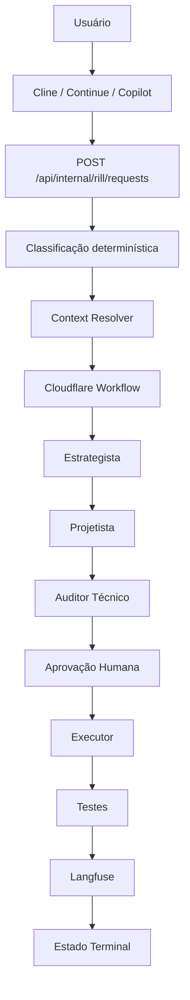

# Sistema Rill

O **Rill** é o Control Plane de Inteligência Artificial do M4QNA One. Ele não é um modelo de IA, não é um chat e não substitui as regras de negócio.

Sua função é controlar qualquer execução de IA para que ela seja:

- autorizada;
- rastreável;
- limitada em escopo;
- segura;
- observável;
- economicamente controlada;
- submetida à aprovação humana quando necessário.

Cline, Continue, Copilot, Qwen, Claude, Gemini e outros modelos são apenas **clientes ou mecanismos de execução**. Nenhum deles possui autoridade para decidir sozinho o que pode ser lido, alterado, executado ou aprovado.

## Fluxo principal



## 1. Cliente

O usuário conversa com uma interface, como:

- Cline;
- Continue.dev;
- GitHub Copilot;
- outra integração MCP;
- uma aplicação própria.

Essas interfaces não devem analisar livremente o repositório nem gerar código imediatamente.

Elas devem enviar a solicitação ao Rill.

Exemplo:

> Analise a UI da página Audit Q em `index.html`.

O cliente envia essa solicitação para:

`POST /api/internal/rill/requests`

## 2. Classificação determinística

O Rill não permite que o modelo invente a classificação.

A classificação é feita por código e pelo `engineering-registry.json`.

O sistema determina:

- ação;
- domínio;
- especialista;
- nível de contexto;
- necessidade de aprovação;
- motivo;
- estado inicial.

Para o pedido:

> Analise a UI da página Audit Q em `index.html`.

O resultado esperado é:

- Ação: `PLAN_CHANGE`
- Domínio: `AuditQ`
- Especialista: Planner/Estrategista
- Perfil: `LOW_COST`
- Contexto: limitado aos arquivos permitidos
- Estado: autorizado para planejamento

Se o pedido for:

> Crie um componente React para uma tela de login.

O Rill não deve assumir que isso pertence ao domínio AuditQ. Ele retorna bloqueio ou exige expansão explícita de contexto.

## 3. Engineering Registry

O `engineering-registry.json` é o principal registro operacional do Rill.

Ele define:

- ações permitidas;
- domínios autorizados;
- arquivos permitidos;
- arquivos proibidos;
- extensões válidas;
- limite de arquivos modificados;
- perfil de modelo;
- validações obrigatórias;
- necessidade de aprovação humana;
- limite de contexto.

Exemplo conceitual:

- `PLAN_CHANGE x AuditQ`: planejamento sem alteração.
- `PATCH_UI x AuditQ`: alteração de UI, com aprovação.
- `VALIDATE_CHANGE x AuditQ`: revisão e validação read-only.

O modelo não pode ignorar esse registro.

## 4. Context Resolver

O `Context Resolver` é uma regra determinística. Ele não é uma IA.

Sua função é descobrir quais arquivos podem ser usados como contexto.

Ele verifica:

- se o alvo foi explicitamente informado;
- se o arquivo existe;
- se está no `allowedPaths`;
- se não está em `forbiddenPaths`;
- se a extensão é permitida;
- se o limite de arquivos foi respeitado;
- se o limite estimado de tokens foi respeitado;
- quais documentos baseline e testes são relevantes.

Se a solicitação não indicar um arquivo ou contexto suficiente, o Rill retorna:

`CONTEXT_EXPANSION_REQUIRED`

Isso evita que um modelo leia o projeto inteiro ou preencha lacunas com conhecimento genérico.

## 5. Workflow durável

Depois que a solicitação passa pela classificação e pelo contexto, o Rill cria uma instância do Workflow `rill-execution`.

O Workflow é responsável por:

- manter o estado;
- executar etapas duráveis;
- controlar retries;
- aguardar aprovação;
- retomar após uma decisão;
- registrar falhas;
- encerrar a missão.

Estados previstos:

- `CLASSIFIED`
- `CONTEXT_READY`
- `PLANNED`
- `PROPOSAL_REVIEWED`
- `AWAITING_HUMAN_APPROVAL`
- `EXECUTING`
- `VALIDATING`
- `COMPLETED`
- `BLOCKED`
- `FAILED`
- `REJECTED`
- `REQUESTED_CHANGES`
- `CANCELED`

O Workflow não deve possuir regras financeiras, fiscais ou de marketplace. Ele apenas coordena o processo.

## 6. Especialistas

Os nomes Planner, Builder e Reviewer representam papéis, não modelos fixos.

### Estrategista

Também chamado de Architect ou Planner.

Responsável por:

- entender a tarefa;
- dividir o problema;
- criar um plano;
- trabalhar em modo read-only;
- não modificar arquivos.

Pode usar um modelo `LOW_COST`, como Gemini Flash, quando o Registry permitir.

### Projetista

Também chamado de Builder na fase de proposta.

Responsável por:

- transformar o plano em uma proposta técnica;
- produzir um `PATCH_PROPOSAL`;
- indicar arquivos-alvo;
- definir critérios de aceite;
- listar riscos;
- indicar testes recomendados.

Ele não pode aplicar a alteração diretamente.

### Auditor Técnico

Também chamado de Reviewer.

Responsável por:

- conferir o escopo;
- verificar arquivos permitidos;
- detectar arquivos proibidos;
- validar o schema;
- avaliar riscos;
- revisar a proposta;
- verificar evidências;
- executar validações pós-aplicação.

O Auditor não deve corrigir automaticamente sua própria revisão.

## 7. Seleção de modelo

O usuário escolhe o objetivo, não o modelo definitivo.

O Rill consulta:

- ação;
- domínio;
- risco;
- perfil definido no Registry;
- custo;
- limite de contexto;
- necessidade de saída estruturada;
- disponibilidade do provedor.

O Gateway OpenRouter então resolve o modelo efetivo.

O cliente deve mostrar algo como:

- Cargo: Estrategista;
- Perfil: `LOW_COST`;
- Modelo efetivo: modelo configurado no catálogo;
- Motivo: planejamento read-only de baixo risco;
- Status: `PLANNING`.

O modelo não pode escolher outro perfil para escapar de limites ou aprovações.

## 8. Segurança

Antes de qualquer chamada externa, o Rill deve aplicar:

1. minimização de dados;
2. allowlist de campos;
3. DTO específico da tarefa;
4. detecção de dados sensíveis;
5. validação de segurança;
6. validação de política;
7. validação da saída.

Não devem ser enviados para o modelo:

- senhas;
- tokens;
- chaves;
- dados pessoais;
- CPF;
- CNPJ;
- dados bancários;
- identificadores fiscais;
- payloads completos de domínio;
- objetos financeiros crus.

Se a segurança não puder ser comprovada, a execução deve ser bloqueada.

## 9. Aprovação humana

Quando uma operação exige aprovação, o Workflow entra em:

`AWAITING_HUMAN_APPROVAL`

Nesse momento, o Rill cria um ticket HITL.

O Diretor da Obra pode decidir:

- `APPROVED`;
- `REJECTED`;
- `REQUESTED_CHANGES`.

Somente `APPROVED` permite avançar para execução.

O modelo não pode aprovar a própria proposta. O Reviewer também não substitui a aprovação humana quando o Registry exige intervenção.

## 10. Executor

O Executor é diferente do Builder-Projetista.

Ele não pensa e não escolhe. Ele apenas aplica uma proposta previamente aprovada.

Antes de executar, deve confirmar:

- ticket aprovado;
- hash da proposta;
- arquivos autorizados;
- limite de arquivos;
- extensões permitidas;
- ausência de divergência;
- contexto correto;
- estado correto do Workflow.

O Executor não deve:

- criar uma solução nova;
- alterar arquivos não aprovados;
- modificar regras financeiras;
- executar migrations automaticamente;
- fazer commit;
- fazer push;
- fazer deploy.

## 11. Testes e validação

Depois da execução, o Reviewer verifica:

- diff real;
- escopo;
- Registry;
- schema;
- testes;
- lint;
- evidência visual, quando necessária;
- ausência de secrets;
- ausência de alteração em áreas protegidas.

Se os testes falharem, a missão não deve ser concluída como sucesso.

## 12. HITL e Supabase

O Supabase deve persistir:

- execução;
- ticket;
- decisão;
- auditoria;
- referência do Workflow;
- timestamps;
- ator da decisão;
- justificativa.

A persistência deve usar:

- RLS;
- menor privilégio;
- trilha de auditoria;
- decisões atribuíveis;
- nenhuma credencial no código;
- nenhum payload sensível desnecessário.

## 13. Observabilidade Langfuse

O Langfuse recebe telemetria redigida da execução:

- `executionId`;
- Workflow;
- estado;
- cargo;
- modelo;
- provedor;
- tokens;
- custo;
- latência;
- retries;
- resultado;
- versão do prompt;
- versão do catálogo.

A falha do Langfuse não deve interromper uma execução válida, mas toda chamada de modelo deve tentar gerar telemetria.

## 14. MCP do Cline

O Cline deve possuir apenas três operações principais:

- `rill_create_request`;
- `rill_get_execution`;
- `rill_submit_decision`.

A primeira ação obrigatória do Cline é:

`rill_create_request`

Antes disso, o Cline não deve:

- ler arquivos;
- fazer busca;
- usar terminal;
- gerar código;
- criar plano;
- editar arquivos.

A configuração do MCP usa:

- `RILL_BASE_URL`;
- `RILL_AUTHORIZATION`;
- timeout interno;
- `autoApprove` vazio.

O Cline é apenas um cliente. A autoridade permanece no Rill.

## 15. Encerramento da missão

O looping termina quando o Workflow entra em um estado terminal:

- `COMPLETED`;
- `BLOCKED`;
- `FAILED`;
- `REJECTED`;
- `REQUESTED_CHANGES`;
- `CANCELED`.

Depois disso:

- o Workflow não continua;
- não há polling infinito;
- nenhum modelo fica ativo;
- não há consumo de tokens em background;
- o cliente apenas exibe o relatório final.

## Resumo final

O Rill funciona como uma camada de controle entre o usuário e qualquer modelo de IA:

```text
Usuário
→ Cliente MCP
→ Rill
→ Classificação determinística
→ Context Resolver
→ Registry
→ Workflow
→ Especialista
→ Auditor
→ Aprovação humana
→ Executor
→ Testes
→ Langfuse
→ Estado terminal
```

A principal regra é:

> Nenhum cliente, modelo ou agente possui autoridade própria. Todos devem solicitar autorização ao Rill, operar dentro do contexto autorizado e obedecer ao estado do Workflow.