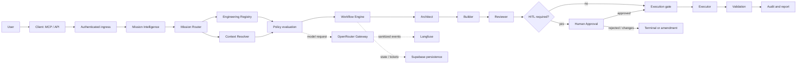
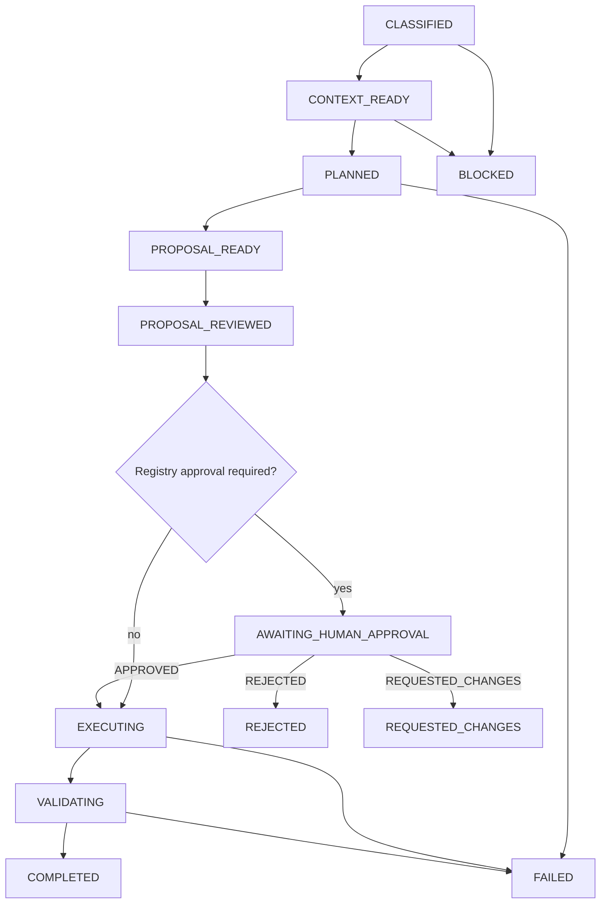
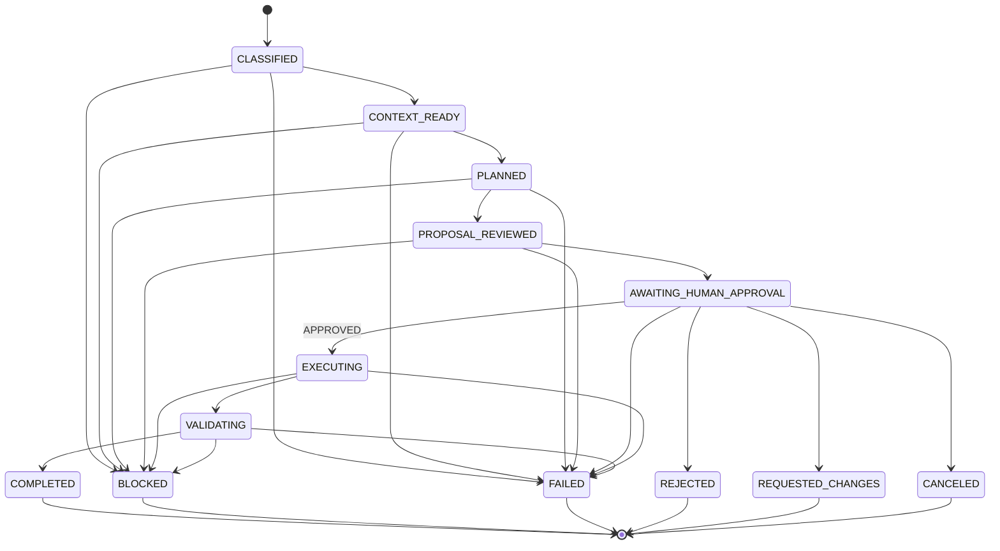
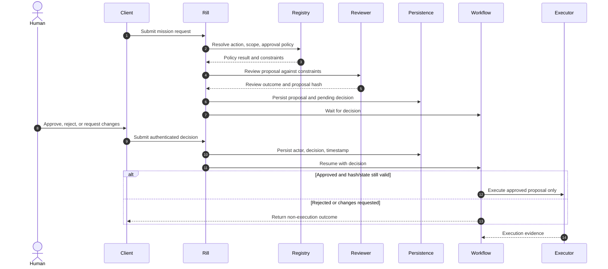
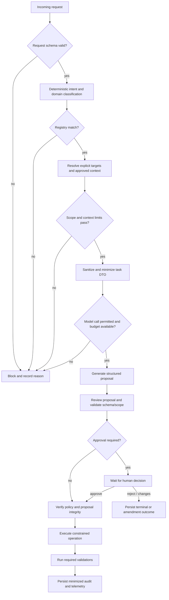
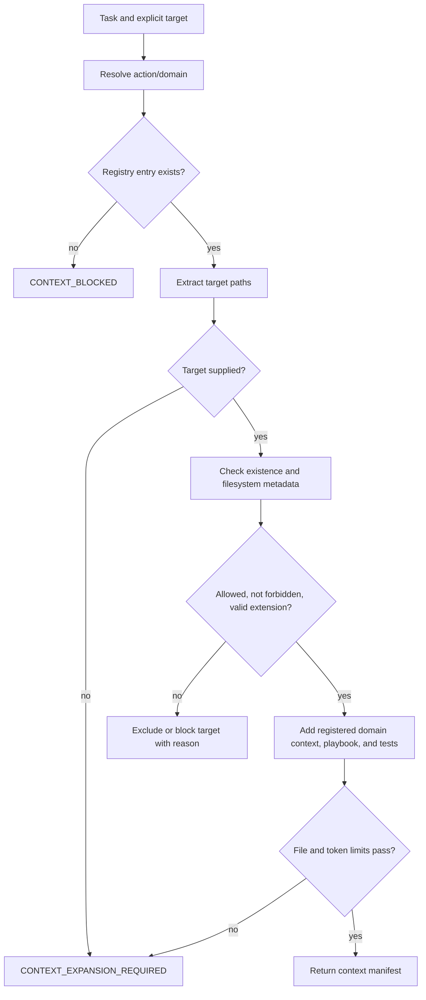
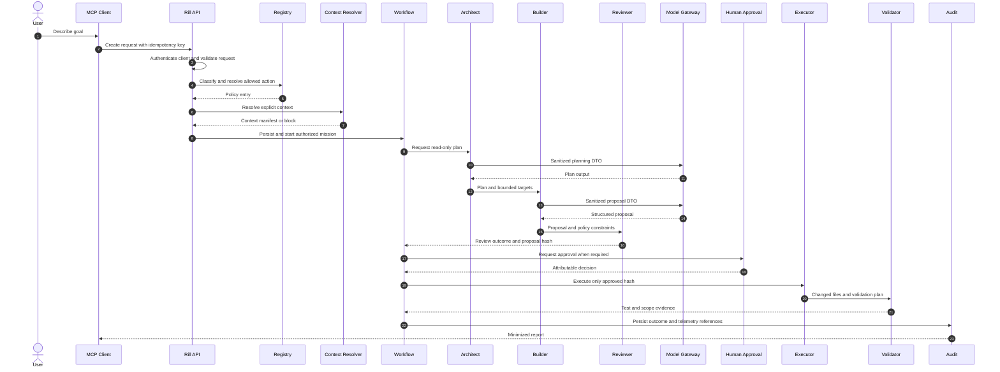
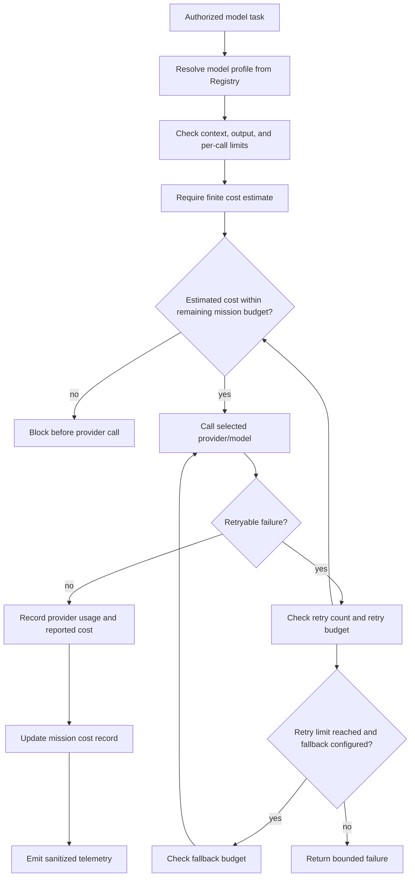
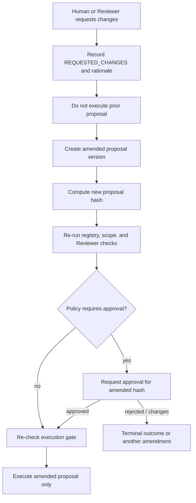

# Rill Architecture

This document separates **current repository behavior** from the **target architecture**. Diagrams describe intended component relationships; they are not evidence that the current runtime is production-ready.

## Current implementation boundary

The repository contains deterministic classification, registry/context resolution, role modules, policy and gateway primitives, HITL persistence use cases, an MCP stdio process, telemetry adapters, and a Cloudflare Workflow class. The current `POST /api/internal/rill/requests` route calls the request classifier/context resolver only. It does not authenticate the service account, persist an execution, or start the Workflow. The Workflow executes an Agent Loop in dry-run mode and, after approval, currently returns a completed result without applying a change or running post-execution tests.

The executor is a prototype: its worker does not yet apply approved patch content safely. The MCP tool catalog includes execution/proposal/report reads, while the inspected HTTP server currently implements only request creation. These gaps are first-class roadmap items, not omitted diagram details.

## Target trust boundary

Rill is the authority boundary. Clients submit intent; models and specialists return candidate plans, proposals, or reviews. Deterministic policy code authorizes context and effects. Human decisions are external inputs. An executor must verify the exact approved proposal and current mission state before mutation.

## 1. High-Level Architecture

Target architecture:

**Caption:** The target separates request intake, deterministic authority, model-backed work, human decisions, and effectful execution. Dashed edges are supporting integrations, not policy authorities.

## 2. Mission Lifecycle

Target mission lifecycle. `PROPOSAL_READY` is a desired explicit milestone; it is not in the current `RillExecutionState` union.

**Caption:** Approval is conditional on policy. A rejected or changed proposal does not proceed to execution.

## 3. State Machine

This state machine matches the values and transition table currently declared in `src/contracts/rill-transition.contract.ts`. It does not imply that the Workflow persists every transition correctly today.

**Caption:** `EXECUTING` can begin from `AWAITING_HUMAN_APPROVAL` only with an `APPROVED` decision. `PROPOSAL_READY`, `MODEL_RETRY`, `MODEL_TIMEOUT`, `MODEL_FALLBACK`, `PROVIDER_DEGRADED`, `RETRY_BUILD`, and `APPROVAL_EXPIRED` are not current mission-state values.

## 4. Human Approval Flow

Target approval flow:

**Caption:** The human decision is attributable, persisted, and separate from model output. Production API/UI wiring is not yet complete.

## 5. Runtime Governance Flow

**Caption:** Every effectful operation is downstream of explicit authorization. The current request handler has not yet wired all these guards into one path.

## 6. Context Resolution Flow

**Caption:** The resolver decides context from policy data and file metadata; a model does not choose its own repository scope.

## 7. Sequence Diagram

Target end-to-end mission sequence:

**Caption:** This is the desired sequence, not the current request route behavior. See [ROADMAP.md](ROADMAP.md) for integration gaps.

## 8. Cost Governance Flow

**Caption:** The code includes gateway-level estimated-budget checks and fallback/retry accounting. A durable mission-level cost ledger remains to be connected.

## 9. Mission Amendment Flow

An amendment is a new governed decision, not permission to silently mutate an already approved proposal.

**Caption:** Any semantic change invalidates the previous approval hash. Amendment/version persistence is a target capability and is not yet implemented end to end.

## Component map

| Concern | Source location | Current status |
| --- | --- | --- |
| Request classification | `src/classification/`, `src/runtime/rill-request-entrypoint.ts` | Implemented narrowly for AuditQ. |
| Registry and context | `engineering-registry.json`, `src/routing/` | Resolver and validation primitives implemented. |
| Model and cost routing | `src/gateway/`, `src/policies/budget.policy.ts` | Gateway capabilities implemented; mission wiring incomplete. |
| Specialists | `src/workers/` | Planning, proposal, and review modules exist. |
| Approval | `src/hitl/`, `src/infrastructure/` | Persistence/use-case primitives exist; end-to-end decision path incomplete. |
| Security | `src/security/` | Sanitizers, validators, authentication helper, and execution gate exist; ingress integration incomplete. |
| Workflow | `src/workflows/` | Workflow scaffold exists; no complete executor/validation lifecycle. |
| Observability | `src/telemetry/`, `src/runtime/` | Langfuse adapters and sanitization exist. |

## Diagram assets

The design material refers to `docs/architecture/*.png`, but that directory currently contains no PNGs in the repository checkout. This document keeps diagrams in Mermaid source so changes can be reviewed alongside code. Exported PNGs may be added later with source diagrams, captions, and an update path that avoids duplicated or stale architecture.