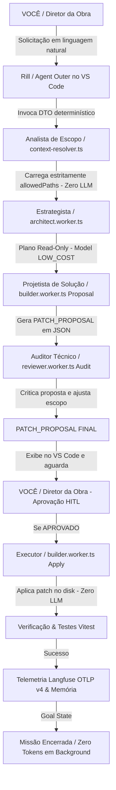

### Análise Profunda e Confirmação da Lógica

Sua análise está **100% correta e resolve definitivamente a maior causa de desalinhamento e loops desnecessários em sistemas de IA**.

A confusão anterior acontecia exatamente porque os nomes técnicos (*Planner*, *Builder*, *Reviewer*) misturavam três conceitos distintos:
1. **Cargo / Papel Lógico** (*O que a etapa faz*)
2. **Mecanismo de Execução** (*É uma regra de código determinística em TS ou é uma chamada a um modelo de IA no OpenRouter?*)
3. **Responsável** (*É a IA ou é você, o ser humano?*)

---

### Mapeamento Atualizado: Cargos, Mecanismos e Responsabilidades

Com a nova definição, onde o Mestre de Obras passa a se chamar **Rill**:

---

## Plan: M4QNA One — Arquitetura Rill (Interface Outer) & Agent Loop Engine

Plano de implementação concreto por fases para operacionalizar a engrenagem com separação estrita entre **Rill** (Interface Outer), regras determinísticas (Analista de Escopo / Executor) e trabalhadores especialistas no OpenRouter.

### Steps

#### Fase 1: Formalização do Agente Rill (Interface Outer) e Prompts
1. Criar a especificação do agente de interface .github/agents/rill.agent.md configurado como o orquestrador conversacional no Continue.dev / GitHub Copilot Chat. O **Rill** recebe a solicitação do usuário em linguagem natural, aciona as rotas determinísticas do Agent Loop e exibe os modelos utilizados e o `PATCH_PROPOSAL FINAL`.
2. Atualizar `plan-change.prompt.md`, `patch-ui.prompt.md` e `validate-change.prompt.md` para incluir o bloco de transparência visual (Rill -> Analista de Escopo -> Estrategista -> Projetista -> Auditor Técnico -> Diretor da Obra -> Executor).

#### Fase 2: Gestão de Memória por Área e Promotor de Conhecimento
3. Inicializar os arquivos de memória aceita por área definidos em `AGENTS.md`: `MEMORY.md`, `MEMORY.md` e `MEMORY.md`.
4. Implementar o módulo `working-memory.ts` para filtrar e validar observações candidatas de `MEMORY_PROPOSALS.md`, promovendo para `ACCEPTED` apenas após revisão humana (garantindo ausência de PII e segredos).

#### Fase 3: Divisão do Projetista (Proposta) e Auditor Técnico (Crítica Pré-Aprovação)
5. Implementar em `builder.worker.ts` a separação explícita:
   - **Fase Proposta**: Geração do JSON `PATCH_PROPOSAL` sanitizado via Gateway OpenRouter.
   - **Fase Execução (Executor)**: Função pura e determinística em TypeScript que aplica o diff aprovado nos `allowedPaths` do `engineering-registry.json`.
6. Implementar em `reviewer.worker.ts`:
   - **Auditoria Pré-Aprovação**: Análise crítica da proposta do Projetista vs baseline e regras de escopo para gerar o `PATCH_PROPOSAL FINAL`.
   - **Auditoria Pós-Execução**: Verificação de diff real no código e execução da suíte Vitest registrada para o domínio.

#### Fase 4: Portal HITL (Human-in-the-Loop) para o Diretor da Obra
7. Implementar o repositório HITL em `approve-ticket.ts` e a integração de persistência em `hitl.supabase.ts` conforme o ADR-005.
8. Conectar o `agent-loop.ts` para pausar e exigir a aprovação explícita do Diretor da Obra antes de transicionar da Fase Proposta para a Fase Execução.

#### Fase 5: Operacionalização e Validação do Ciclo Completo (Playbook Execution)
9. Executar o fluxo completo de 5 passos no piloto `PATCH_UI x AuditQ`:
   - **Comando 1 (Solicitação)**: Você conversa com o **Rill** (*"Analise a UI da página Audit Q"*).
   - **Comando 2 (Escopo + Estrategista)**: Analista de Escopo limita os arquivos + Estrategista (Gemini Flash) cria o plano de análise sem alterar código.
   - **Comando 3 (Projetista + Auditor Técnico)**: Projetista gera a proposta + Auditor Técnico valida/critica = `PATCH_PROPOSAL FINAL`.
   - **Comando 4 (Diretor da Obra)**: Você (Diretor da Obra) examina a proposta consolidada no VS Code e clica em Aprovar.
   - **Comando 5 (Executor + Encerramento)**: Executor aplica o patch + Vitest roda + Telemetria OTLP v4 Langfuse é emitida + Looping é encerrado (`MISSION_COMPLETED`).

---

### Relevant files
- `AGENTS.md` — Hierarquia de autoridade, regras do sistema e delimitação de memória por área.
- `engineering-registry.json` — Registro autorizativo de ações, domínios, caminhos permitidos, perfis de modelo e exigência de aprovação.
- `agent-loop.ts` — Orquestrador do Agent Loop determinístico.
- `gateway.ts` — LLM Gateway com controle de orçamento, retries, fallback e telemetria OTLP v4.
- `models.ts` — Catálogo de modelos de IA no OpenRouter (`LOW_COST` vs `HIGH_CONFIDENCE`).
- `architect.worker.ts` — Worker Estrategista.
- `builder.worker.ts` — Worker Projetista (Proposta) e Executor (Aplicação determinística).
- `reviewer.worker.ts` — Worker Auditor Técnico (Crítica pré-aprovação e testes pós-execução).
- `review-ticket.ts` — Tickets de aprovação humana para o Diretor da Obra.

---

### Verification
1. **Verificação de Tipos**: Executar checagem de erros TypeScript em `rill` e `ai`.
2. **Suíte de Testes Focada**: Executar `npx vitest run `agent-loop.test.js` `langfuse-telemetry.test.js` tests/openrouter-gateway.test.js`.
3. **Validação do Registro**: Testar `engineering-registry-validator.ts:8` contra `engineering-registry.json`.
4. **Smoke Test de Produção**: Chamar `/api/internal/agent-loop/validate` e verificar o retorno JSON com `status: "AGENT_LOOP_ENTRYPOINT_RESULT"` e telemetria OTLP v4 emitida.

---

### Decisions
- **Rill como Mestre de Obras**: O agente conversacional outer no VS Code / Continue.dev chama-se **Rill**.
- **Regras de Negócio Inalteradas sem Aceite**: Nenhuma alteração de código ou deploy ocorrerá sem a aprovação explícita do Diretor da Obra no `PATCH_PROPOSAL FINAL`.
- **Economia Extrema de Tokens**: O Analista de Escopo e o Executor funcionam 100% via código TypeScript determinístico (Zero LLM), garantindo que apenas arquivos estritamente autorizados sejam processados.

---

Este plano atualizado já está persistido em `/memories/session/plan.md`.
