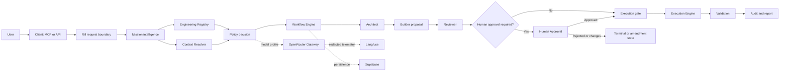
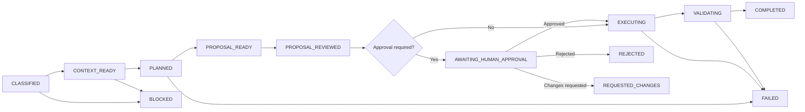
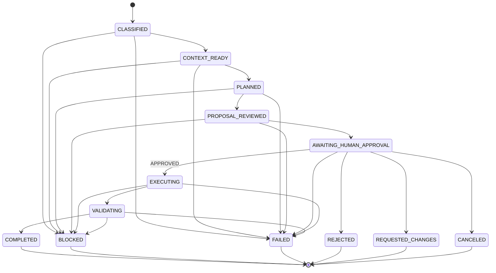

<p align="center">
	
</p>

<h1 align="center">Rill</h1>

<p align="center"><strong>Mission Intelligence &amp; Governance Layer for AI Systems</strong></p>

<p align="center">Agents execute work. Rill governs work.</p>

<p align="center">
	<a href="LICENSE"></a>
	
	
	
	
	
	
	
</p>

<p align="center">
	<a href="https://rill.wesleysmacedo.com">Website</a> ·
	<a href="ARCHITECTURE.md">Architecture</a> ·
	<a href="ROADMAP.md">Roadmap</a> ·
	<a href="CONTRIBUTING.md">Contributing</a> ·
	<a href="SECURITY.md">Security</a>
</p>

> [!IMPORTANT]
> Rill is an early-stage open-source project. This repository contains working policy, routing, gateway, worker, persistence, and workflow building blocks, but its request API does **not yet** connect the complete authenticated mission lifecycle end to end. See [Project status](#project-status) before using it to authorize real changes.

## Mission Statement

Rill is a control plane for AI-assisted engineering work. It is designed to turn a user's goal into a mission whose intent, domain, context, risk, model profile, approval requirements, execution, and outcome are governed by explicit policy.

Rill is not an AI model, coding assistant, chatbot, code editor, VS Code or Cursor replacement, or model provider. Clients and models can propose or perform work only within authority granted by Rill's policies.

**Core principle:**

```text
Agents execute work.
Rill governs work.
```

## Why Rill Exists

An agent that can inspect files, call tools, or change a system also creates operational risk. Prompt instructions alone are not a durable authorization boundary: they can be ambiguous, incomplete, or bypassed by a client or model.

Rill explores a different boundary. A request is first classified against an engineering registry. A deterministic resolver limits the context. Policy selects permitted actions and approval requirements. A workflow coordinates specialist roles and records outcomes. Human approval is required where policy says it is.

The objective is not to make models authoritative. It is to make model-assisted work bounded, attributable, inspectable, and stoppable.

## Problem Statement

AI coding systems commonly combine user intent, repository access, model selection, tool execution, and approval in one client-side loop. This makes it difficult for a team to answer questions such as:

- Was this action authorized for this domain?
- Which files and data were in scope?
- Which model profile and budget were allowed?
- Was a human decision required and recorded?
- Did the applied change match the reviewed proposal?
- Which validations ran, and what evidence supports completion?

Rill is designed to make these decisions explicit and enforceable at a control boundary rather than relying exclusively on client conventions.

## Design Principles

1. **Policy before inference.** Classify and authorize before sending task context to a model.
2. **Least context.** Resolve only registered, relevant inputs; fail closed when the target or scope is unclear.
3. **Deterministic authority.** Models may recommend; application policy decides what is permitted.
4. **Human authority remains external.** A model, worker, or MCP client cannot approve its own proposal.
5. **Proposal before mutation.** Separate planning and review from applying changes.
6. **Bounded execution.** Constrain files, extensions, costs, retries, and workflow transitions.
7. **Auditable outcomes.** Preserve attributable decisions and minimized execution evidence.
8. **Provider separation.** Keep model routing and execution policy above any particular provider.
9. **Fail closed.** Unknown domains, invalid context, policy errors, and untrusted outputs must not silently authorize work.
10. **Document implementation honestly.** Architecture diagrams distinguish current code from target behavior.

## Core Concepts

| Concept | Meaning |
| --- | --- |
| Mission | A governed unit of work with an identity, action, domain, lifecycle, and outcome. |
| Mission intelligence | Deterministic and model-assisted analysis used to classify intent, risk, scope, and strategy. |
| Engineering Registry | Versioned policy data mapping action and domain to scope, limits, approvals, and validations. |
| Context manifest | The resolved list of included and excluded context items and why they were selected. |
| Specialist | A role such as Architect, Builder, or Reviewer; not a fixed model. |
| Proposal | A structured description of intended changes, targets, acceptance criteria, risks, and tests. |
| HITL | Human-in-the-loop approval or change request at a policy-defined gate. |
| Execution gate | Checks that approval, workflow state, and approved proposal integrity permit an action. |
| Mission state | A contract-defined lifecycle value used to constrain transitions and report progress. |

## Architecture Overview

The intended path is: **user → client → Rill → registry and context resolution → workflow → specialist roles → human approval, when required → execution → validation and audit**.

The implementation is not yet fully wired to that target. The current HTTP request route classifies and resolves context but does not authenticate the service account, persist a mission, or start the Cloudflare Workflow. The Workflow and runtime modules exist, but their end-to-end behavior must not be inferred from the diagram alone.

### High-Level Architecture



The architecture illustrations supplied during design are not present as PNG files in `docs/architecture/` in this checkout. Mermaid diagrams in [ARCHITECTURE.md](ARCHITECTURE.md) are the checked-in, reviewable source diagrams; add exported images there when they are available.

## System Components

| Component | Responsibility | Repository status |
| --- | --- | --- |
| Mission Intelligence and classifier | Map requests to known actions and domains; reject unknown work. | Deterministic classification exists; current request path supports a narrow AuditQ scope. |
| Mission Router | Select policy, role, and model profile for a mission. | Routing primitives exist; broader multi-domain routing is planned. |
| Engineering Registry | Define allowed paths, actions, limits, validations, and approval policy. | JSON registry, schema, resolver, and tests exist. |
| Context Resolver | Resolve explicit targets and catalogued context under registry limits. | Resolver and tests exist; production filesystem/auth integration is incomplete. |
| Policy Engine | Enforce authorization, execution, security, and cost policies. | Policy modules exist; full request-to-execution enforcement is in progress. |
| Workflow Engine | Coordinate durable steps, state, waits, and terminal outcomes. | Cloudflare Workflow class exists; request/API wiring and full execution path are incomplete. |
| Human Approval | Record attributable approval, rejection, or requested changes. | HITL use cases and persistence adapters exist; SaaS decision surface and complete workflow connection are not included here. |
| Execution Engine | Apply the exact approved proposal within its authorized scope. | Gate and prototype worker exist; safe patch application is not production-ready. |
| Audit System | Produce minimized, attributable execution evidence and reports. | Contracts and persistence/telemetry primitives exist; complete report API is not wired. |
| Cost Governance | Enforce estimates, per-attempt limits, retries, and fallback budgets. | Budget evaluation and gateway integration exist; end-to-end mission accounting is in progress. |
| Security Layer | Sanitize model inputs, validate scope, protect secrets, and gate execution. | Several controls exist; ingress authentication must be wired before production use. |
| Observability | Emit execution and model telemetry. | Langfuse integration and sanitizers exist; telemetry is best-effort and configuration-dependent. |

## Mission Lifecycle

The target lifecycle below includes `PROPOSAL_READY` to make proposal generation explicit. The current TypeScript execution contract does not yet include that state; it uses `PROPOSAL_REVIEWED` after `PLANNED`.



`COMPLETED`, `BLOCKED`, `FAILED`, `REJECTED`, `REQUESTED_CHANGES`, and `CANCELED` are terminal in the current transition contract. `PROPOSAL_READY` and timeout/retry states shown in design material are not current `RillExecutionState` values.

## State Machine

This diagram follows the state values and transitions declared in `src/contracts/rill-transition.contract.ts`. The workflow implementation must still persist and exercise those transitions consistently before the complete lifecycle can be considered operational.



## Human-In-The-Loop

HITL is a policy gate, not a model capability. The intended flow is to persist a proposal and its identity, present the proposal to an authenticated human, record the actor and decision, and resume the workflow only after verifying the decision and approved proposal hash.

The repository contains approval/rejection/request-changes use cases, Supabase persistence helpers, and an executor gate. It does not include a production approval UI or a fully connected approval-to-executor path. The MCP server intentionally does not expose a decision tool in its current tool list. See the detailed [HITL flow](ARCHITECTURE.md#human-approval-flow).

## Engineering Registry

`engineering-registry.json` is the policy input for permitted engineering work. Its schema currently supports `PLAN_CHANGE`, `PATCH_UI`, and `VALIDATE_CHANGE` for the `AuditQ` domain. Entries define:

- allowed and forbidden paths and allowed extensions;
- risk and execution profile;
- model profile;
- maximum changed files and context limits;
- approval requirement and reason;
- required validations, domain context, playbook, and applicable tests.

The registry is validated in code and tested. It is intentionally data-driven, but this repository currently demonstrates a narrow domain rather than a general-purpose enterprise policy catalog.

## Context Resolver

The Context Resolver requires an explicit target, verifies the target against registry scope and the supplied filesystem abstraction, adds registered supporting context, and enforces file/token limits. Missing targets return `CONTEXT_EXPANSION_REQUIRED`; invalid or out-of-scope targets are excluded or blocked.

The resolver is deterministic. It does not ask a model to decide which files are authorized. Production safety also depends on providing a trustworthy filesystem implementation and enforcing access at the actual data boundary.

## Governance Model

Rill separates **recommendation** from **authority**:

- The client submits intent and receives a minimized status or result.
- The registry and policy code determine whether the action is allowed.
- Specialists produce plans, proposals, or reviews within the authorized scope.
- A human decides at gates required by policy.
- An execution gate verifies approval, state, and proposal integrity before mutation.
- Validation and audit evidence determine the terminal outcome.

No diagram or policy file alone provides these guarantees. Enforcement must run on every ingress and effectful operation, and credentials must be least-privileged.

## Cost Governance

The gateway checks configured model profiles, context/output limits, estimated costs, retries, and fallback budgets. It records reported and estimated cost separately and can mark cost as unknown when provider data is unavailable. The request lifecycle does not yet expose a complete, persisted mission-level cost ledger.

See the [cost governance flow](ARCHITECTURE.md#cost-governance-flow) and `src/policies/budget.policy.ts`.

## Security Model

Security controls in the repository include request validation, context/scope checks, input sanitization, data masking and redaction utilities, model catalog validation, transition checks, and an approval/hash execution gate. These are implementation primitives, not a security certification.

**Do not use the current request endpoint as a production authorization boundary.** Its service-account authentication is not wired into the route. Do not send secrets, personal data, credentials, or unrestricted repository content to model providers. Review [SECURITY.md](SECURITY.md) before reporting a vulnerability.

## Audit Model

The target audit record associates a mission ID with the requested action/domain, source client, policy decision, context manifest, proposal hash, reviewer outcome, human actor/decision, execution result, validations, cost, and trace reference. Persistence and report contracts/helpers exist, but the complete immutable audit trail and read APIs are not yet connected end to end.

Audit events should be minimized, attributable, access-controlled, and append-only where operationally possible. A trace is diagnostic evidence; it is not by itself proof of authorization or successful validation.

## Observability

The code includes Langfuse telemetry adapters and sanitization, plus model-call metadata such as selected model/provider, token counts, cost, latency, attempt, fallback, and status. Telemetry is best-effort and must not be treated as the authoritative mission ledger. OpenTelemetry is not currently listed as an implemented exporter in this repository.

## OpenRouter Integration

The gateway calls OpenRouter through a configurable model catalog and profile, supports structured output, timeouts, retryable error classification, fallback, budget checks, and optional Langfuse events. Credentials are supplied at runtime; never commit API keys.

Provider routing is an integration point, not a claim that every model or provider has equivalent behavior, privacy terms, or structured-output guarantees. Evaluate each configured provider against the deployment's data policy.

## Workflow Engine

`src/workflows/rill-execution.workflow.ts` uses Cloudflare Workflows primitives for durable steps and a human-decision wait. In the current implementation it runs the Agent Loop in dry-run mode and returns a completed result after approval without applying changes or running post-execution tests. Request creation does not yet start this Workflow. Treat the Workflow as an in-progress orchestration scaffold, not a production execution service.

## Specialists

| Role | Intended responsibility | Current code boundary |
| --- | --- | --- |
| Architect | Analyze the authorized task and produce a read-only plan. | `architect.worker.ts`; used by the Agent Loop. |
| Builder | Turn an approved scope and plan into a structured change proposal. | `builder.worker.ts`; proposal generation is present, safe patch application is incomplete. |
| Reviewer | Check proposal scope and later inspect execution evidence. | `reviewer.worker.ts`; proposal and post-execution audit functions exist. |
| Executor | Apply only the approved proposal and make no new decisions. | Gate/prototype exists; production-grade application is not implemented. |
| Human Approval | Approve, reject, or request changes as an attributable person. | HITL operations exist; production UI and end-to-end workflow wiring are incomplete. |

Roles are capabilities and policy boundaries, not fixed model identities.

## Runtime Policies

Runtime policy modules cover execution, security, budget, registry validation, context limits, and state transitions. The intended evaluation order is authorization first, context and data checks next, model invocation only after policy passes, then human approval and execution gates where required. Runtime enforcement is being connected; see the status and roadmap before relying on any single module as a complete control plane.

## Architecture Decision Records

ADRs record decisions that affect interfaces, trust boundaries, or long-term operations. The initial decision is [ADR 0001: Rill is a control plane](docs/adr/0001-rill-is-a-control-plane.md). Proposed decisions should be discussed before implementation and should document context, decision, consequences, and status.

## Directory Structure

```text
.
├── docs/
│   ├── adr/                  # Architecture Decision Records
│   └── architecture/         # Architecture diagrams (PNG assets not yet checked in)
├── migrations/               # Database migrations
├── public/assets/            # Project assets
├── src/
│   ├── classification/       # Deterministic request classification
│   ├── cli/                  # MCP stdio server
│   ├── contracts/            # Execution, workflow, policy, cost, and telemetry contracts
│   ├── gateway/              # Model catalog and OpenRouter gateway
│   ├── hitl/                 # Human approval use cases
│   ├── infrastructure/      # Supabase persistence adapters
│   ├── memory/               # Working-memory contracts and implementation
│   ├── policies/             # Budget, execution, and security policy modules
│   ├── routing/              # Registry, context, model, and worker routing
│   ├── runtime/              # Request entrypoint and Agent Loop
│   ├── security/             # Sanitization, validation, auth, and execution gate
│   ├── telemetry/             # Langfuse integration
│   ├── workers/              # Architect, Builder, and Reviewer roles
│   └── workflows/            # Cloudflare Workflow implementations
├── tests/                    # Vitest test suite
├── engineering-registry.json
├── engineering-registry.schema.json
└── package.json
```

## Local Development

### Prerequisites

- Node.js compatible with the installed TypeScript and Vitest versions.
- npm.
- A supported runtime environment for Cloudflare-specific Workflow modules when testing or deploying those modules.

### Install and test

```bash
npm install
npm test
```

### Run the classifier

```bash
npm run classify -- "Analise a tela em public/index.html"
```

### Run the MCP server

```bash
npm run mcp
```

The MCP server uses stdio. Configure `RILL_BASE_URL`, `RILL_MCP_CLIENT_ID`, and `RILL_MCP_CLIENT_SECRET` for a remote service. The local health check validates configuration presence only. The current Worker route does not yet enforce the service-account credentials; do not treat setting these variables as proof of server-side authentication.

There is no `dev`, build, or deploy script in `package.json` at this stage. Cloudflare deployment instructions will be added when the runtime configuration and end-to-end path are ready.

## Contributing

Community contributions are welcome. Start with [CONTRIBUTING.md](CONTRIBUTING.md), read the [architecture guide](ARCHITECTURE.md), and keep changes aligned with the control-plane boundary. Security reports must follow [SECURITY.md](SECURITY.md), not a public issue.

## Community

Rill is intended to be community-driven. Use GitHub issues for reproducible bugs and focused proposals, and pull requests for reviewable changes. Keep discussion technical, evidence-based, and respectful; see [CODE_OF_CONDUCT.md](CODE_OF_CONDUCT.md).

## Roadmap

The roadmap distinguishes existing code from integration work and future design. See [ROADMAP.md](ROADMAP.md); roadmap items are not release commitments.

## Project Status

Rill is in early development. Unit-tested components are available, but the current repository does not yet provide a complete production flow from authenticated MCP request through durable execution, human approval, safe patch application, validation, and final report. Interfaces and policies may change before a stable release.

## License

The project declares **Apache License 2.0** in `package.json`. Apache-2.0 is a permissive license with explicit patent grants and attribution conditions; it is widely understood by individual contributors and organizations, supports community reuse and enterprise adoption, and permits compatible commercial use. Its contributor and patent terms provide a clearer collaboration baseline than an undocumented license.

This is a project-maintainer recommendation, not legal advice. The full [Apache License 2.0](LICENSE) is included in this repository; confirm copyright ownership and contribution governance before a public release.

Maintainer: [Wesley de Souza Macedo](https://rill.wesleysmacedo.com).
