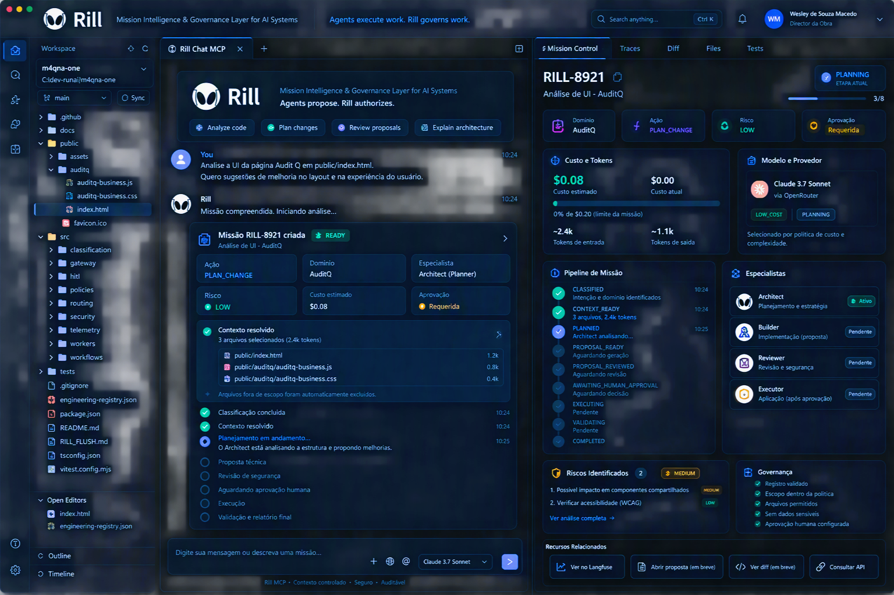
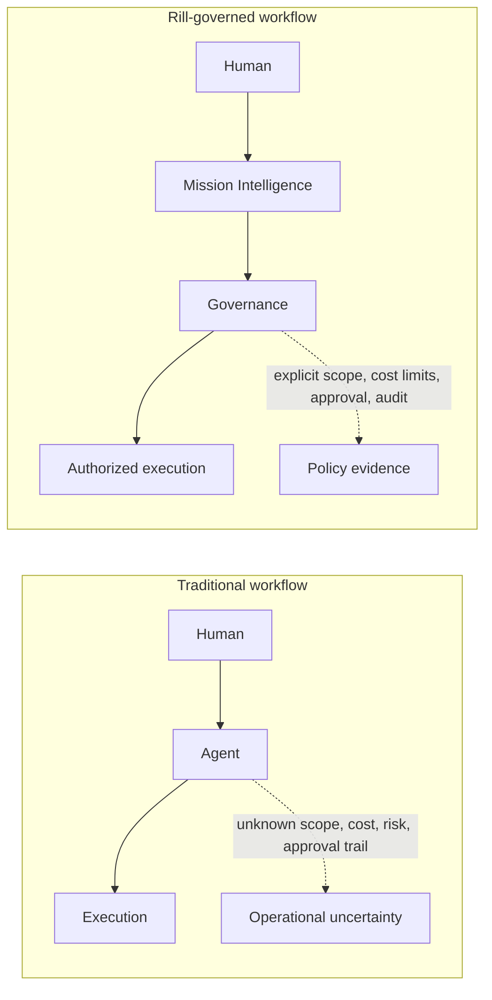
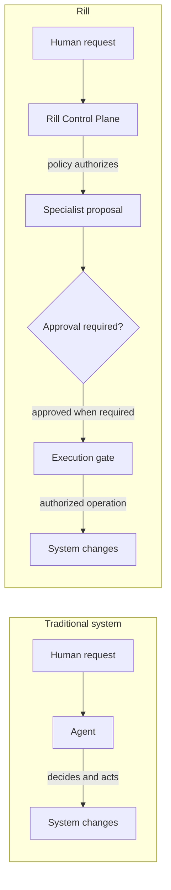
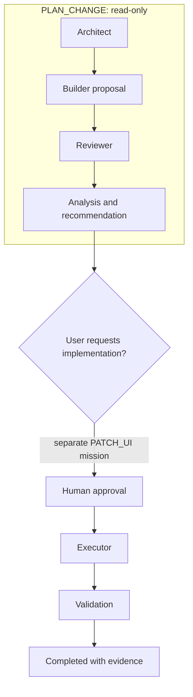
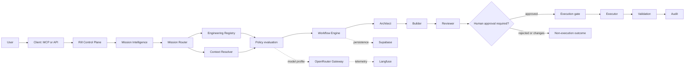
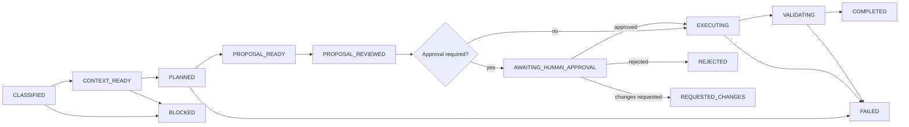
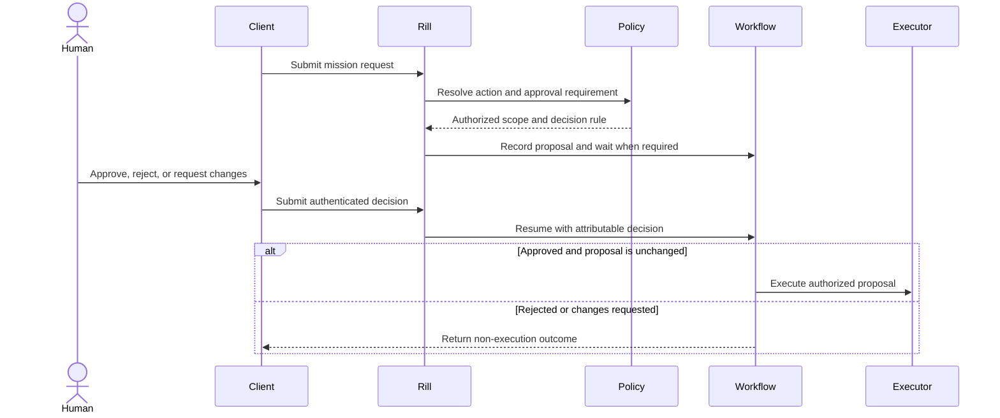
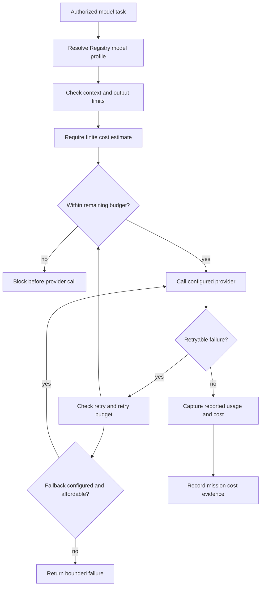

<p align="center">
  
</p>

<h1 align="center">Rill</h1>

<p align="center"><strong>Mission Intelligence &amp; Governance Layer for AI Systems</strong></p>

<p align="center">Agents propose. Rill authorizes.</p>

<p align="center">
  <a href="https://rill.wesleysmacedo.com">Website</a> ·
  <a href="#core-concepts">Documentation</a> ·
  <a href="ARCHITECTURE.md">Architecture</a> ·
  <a href="ROADMAP.md">Roadmap</a> ·
  <a href="CONTRIBUTING.md">Contributing</a> ·
  <a href="SECURITY.md">Security</a>
</p>

<p align="center">
  
  
  
  
  
  
  
  
</p>

> Rill is a control plane for AI-assisted work. It puts policy between an agent's proposal and a system's effects, so teams can define what is allowed before execution begins.

## Product Preview

This is the visual concept of the Rill Mission Control interface: a proposed view of a conversation, mission status, scope, specialists, cost, and governance in one place.

<p align="center">
  
</p>

---

## What Is Rill?

Rill is a **Mission Intelligence & Governance Layer for AI Systems**. It is designed to classify a goal, resolve its authorized scope, apply policy, and coordinate model-assisted work under explicit constraints.

Rill is not an AI model, coding assistant, chatbot, editor, VS Code/Cursor/Cline replacement, or model provider. Clients and models can participate in work; they do not own its authority.

<table>
  <tr>
    <td width="33%"><strong>Explicit scope</strong><br>Resolve work against registered actions, paths, and context limits.</td>
    <td width="33%"><strong>Governed execution</strong><br>Apply policy to model profile, cost, risk, and permitted effects.</td>
    <td width="34%"><strong>Human authority</strong><br>Require an attributable decision when the Registry calls for approval.</td>
  </tr>
</table>

## Why Rill Exists

AI systems can combine user intent, model selection, repository access, tool execution, and approval in one loop. When those decisions stay implicit, teams have less control over scope, cost, risk, and accountability.

Rill separates **authority, planning, execution, approval, and audit**. The goal is simple: let agents help with work while keeping authorization in a policy-controlled layer.

## Traditional Workflow vs. Rill



Rill makes the authorization path explicit: **scope is bounded, cost is governed, approval is human when required, and outcomes are designed to be auditable**.

## Authority Model

Traditional agent systems can give an agent direct authority through its tools. Rill's design places authority in the control plane: an agent can propose work, but only Rill policy can authorize the permitted action and scope.



## Example Mission

**Goal:** Improve the AuditQ user interface.

The Registry defines planning and modification as different missions. A read-only analysis can identify improvements; a later change request is separately classified and must pass its own approval policy.

| Mission | Action | Domain | Risk | Model profile | Effect |
| --- | --- | --- | --- | --- | --- |
| Analyze the UI | `PLAN_CHANGE` | `AuditQ` | `LOW` | `LOW_COST` | Read-only plan; no approval required by the current Registry. |
| Implement an approved UI change | `PATCH_UI` | `AuditQ` | `MEDIUM` | `LOW_COST` | Human approval is required before mutation. |



## Current Status

| ✅ Implemented building blocks | 🚧 In progress | 📋 Planned |
| --- | --- | --- |
| Engineering Registry schema and resolver | Authenticated request ingress and mission persistence | Multi-tenant governance |
| Context Resolver and manifest contracts | End-to-end Workflow integration | Mission Router V2 |
| Policy and budget primitives | Human decision to workflow resumption | Cost forecasting |
| OpenRouter gateway with retry/fallback controls | Safe proposal application and executor | Mission amendment/versioning |
| Langfuse telemetry and sanitization | Post-execution validation, audit, and report APIs | Broader domain and provider support |
| Architect, Builder, and Reviewer modules | Mission-level accounting | Release and support policy |
| HITL operations, persistence helpers, and execution gate | End-to-end authorization tests |  |
| State transition contract and MCP stdio server |  |  |

<details>
<summary>Implementation notes</summary>

- The current `POST /api/internal/rill/requests` route classifies the request and resolves context. It does not authenticate the service account, persist a mission, or start the Workflow.
- The Workflow runs the Agent Loop in dry-run mode. After approval, it does not yet apply a patch or run post-execution tests.
- The Builder apply path is a prototype, not a production-safe patch executor. The MCP advertises status, proposal, and report tools whose read routes are not all implemented.
- The current Registry covers `PLAN_CHANGE`, `PATCH_UI`, and `VALIDATE_CHANGE` for `AuditQ`. `PLAN_CHANGE` is read-only and does not require approval; `PATCH_UI` requires explicit human approval.
- `PROPOSAL_READY` appears in the target flow below but is not part of the current execution-state contract.
- The dashboard image above is a visual concept, not a live product screenshot. Its metrics, approvals, and mission states are illustrative, not live or authoritative. Architecture PNG exports are not checked in under `docs/architecture/`; Mermaid diagrams are used below.
- Badges identify repository integrations and technology choices, not a claim that the full mission lifecycle is deployed or production-ready.

</details>

## Quick Start

Try the local classifier and test suite:

```bash
npm install
npm run classify -- "Analyze the AuditQ UI in public/index.html"
npm test
```

<details>
<summary>Run the MCP stdio server</summary>

```bash
npm run mcp
```

The MCP server uses stdio. Configure `RILL_BASE_URL`, `RILL_MCP_CLIENT_ID`, and `RILL_MCP_CLIENT_SECRET` only when connecting it to a service you control.

</details>

## Core Concepts

| Concept | What it means |
| --- | --- |
| Mission | A governed unit of work with an action, domain, policy, lifecycle, and outcome. |
| Mission Intelligence | Classification and analysis of intent, scope, risk, and execution strategy. |
| Engineering Registry | Versioned rules for actions, domains, paths, limits, approvals, and validations. |
| Context Resolver | Builds a context manifest from explicit targets and registered supporting inputs. |
| Specialist | A role such as Architect, Builder, or Reviewer; not a fixed model. |
| Proposal | A structured description of intended targets, changes, criteria, risks, and tests. |
| HITL | Human-in-the-loop decision at a policy-defined approval boundary. |
| Execution gate | Checks approval, mission state, and proposal integrity before an effect. |

## Architecture Overview

Rill separates request intake and deterministic authorization from model-assisted work and effectful execution. The Registry supplies policy, the Context Resolver builds a bounded manifest, and the Workflow coordinates specialist roles and any required human decision.



## Components

| Component | Responsibility | Repository area |
| --- | --- | --- |
| Mission Intelligence and Router | Classify requests and resolve action, role, and model profile. | `src/classification/`, `src/routing/`, `src/runtime/` |
| Engineering Registry | Define supported action/domain policy, paths, limits, approvals, and validations. | `engineering-registry.json`, `engineering-registry.schema.json` |
| Context Resolver | Resolve explicit target files and registered supporting context. | `src/routing/context-resolver.ts` |
| Policy modules | Apply execution, security, and budget rules. | `src/policies/` |
| Workflow Engine | Coordinate durable steps, waits, and mission state. | `src/workflows/` |
| Specialists | Plan, propose, and review work. | `src/workers/` |
| HITL and execution gate | Record human decisions and verify permission to proceed. | `src/hitl/`, `src/security/gated-executor.ts` |
| Model Gateway | Route structured model calls within profile and budget constraints. | `src/gateway/` |
| Persistence and observability | Store mission-related records and emit sanitized telemetry. | `src/infrastructure/`, `src/telemetry/` |

## Mission Lifecycle



## Governance

Rill's governance model separates decisions from suggestions:

- The Registry and policy code authorize the action, domain, context, and limits.
- Specialists create a plan, proposal, or review within that scope.
- Human approval is required only when policy says it is.
- The executor must verify the approved proposal and current mission state.
- Validation and audit evidence inform the terminal outcome.

### Human approval flow



## Cost Governance

The model gateway checks the configured profile, context and output limits, estimated cost, retries, and fallback budget before and during provider calls. Reported usage and estimated cost are distinct values; unknown provider cost should remain unknown rather than be presented as exact.



## Security

Rill is designed around least authority: explicit context, registered file scope, minimized model inputs, runtime-held credentials, policy checks before effects, and a human decision where required. The control plane should fail closed when classification, scope, validation, or authorization is uncertain.

Do not commit provider credentials or send secrets and personal data to a model without an explicit, reviewed data policy. See [SECURITY.md](SECURITY.md) for reporting guidance.

## Auditability

A useful mission record should make it possible to inspect the action and domain, policy result, context manifest, proposal identity, reviewer findings, human decision, execution result, validation evidence, cost, and trace reference. Audit data should be minimized, attributable, access-controlled, and retained under an explicit policy.

## Observability

The repository includes Langfuse adapters and telemetry sanitization for model and mission-related events. Observability helps explain behavior and cost; it does not replace authorization records or validation evidence.

## Development

Requirements: Node.js and npm.

```bash
npm install
npm test
npm run classify -- "Analyze the AuditQ UI in public/index.html"
```

For the stdio MCP process, run `npm run mcp`. Deployment configuration and runtime secrets are environment-specific; do not place credentials in source files.

## Contributing

Start with [CONTRIBUTING.md](CONTRIBUTING.md), read the architecture notes in [ARCHITECTURE.md](ARCHITECTURE.md), and run `npm test` before opening a pull request. Propose changes that affect authority, policy, states, or persistence through an issue or architecture discussion first.

## Community

Rill is community-driven. Use GitHub issues for focused bug reports and proposals, architecture discussions for tradeoffs, ADRs for accepted decisions, and RFCs for cross-cutting changes. Keep discussion evidence-based and distinguish implemented behavior from proposed design. Follow the [Code of Conduct](CODE_OF_CONDUCT.md).

## Roadmap

| Status | Focus |
| --- | --- |
| ✅ Implemented | Registry/context primitives, specialist modules, model gateway, budget controls, HITL contracts, persistence and telemetry adapters. |
| 🚧 In progress | Authenticated ingress, Workflow wiring, safe execution, validation, mission accounting, and reports. |
| 📋 Planned | Multi-tenant governance, Mission Router V2, cost forecasting, mission amendments, broader domains and providers. |

See [ROADMAP.md](ROADMAP.md) for details.

## License

Rill is licensed under the [Apache License 2.0](LICENSE). The license permits community and commercial use under its terms, including explicit patent provisions. This summary is informational, not legal advice.

Maintained by [Wesley de Souza Macedo](https://rill.wesleysmacedo.com) · [Website](https://rill.wesleysmacedo.com)
