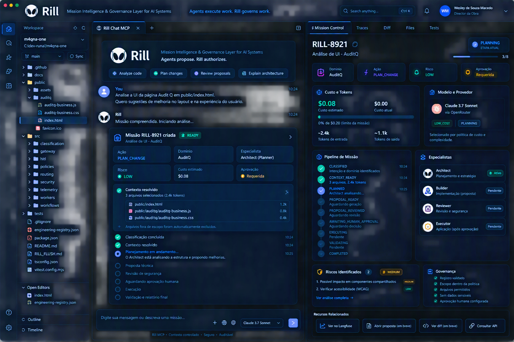
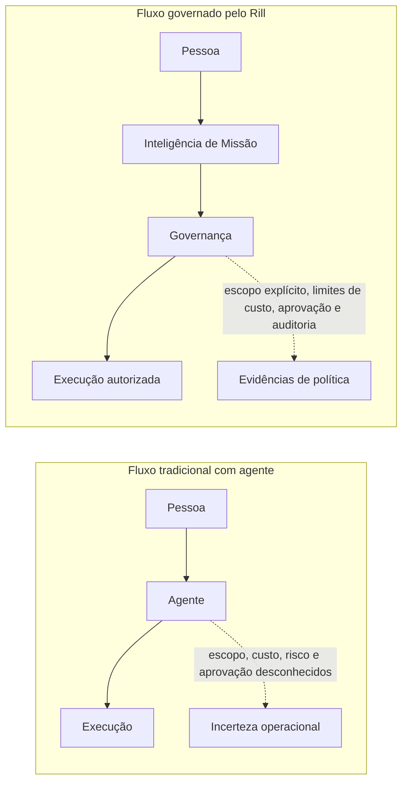
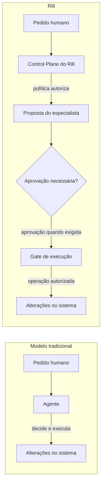
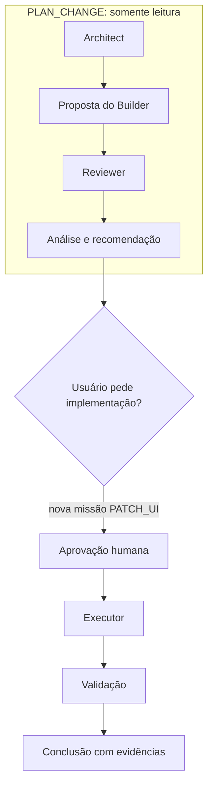
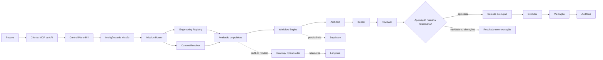
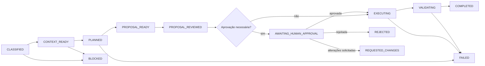
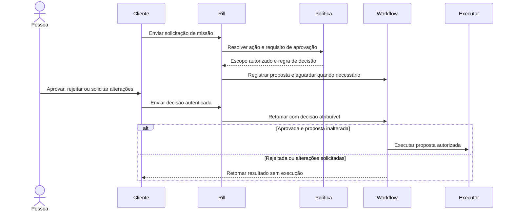
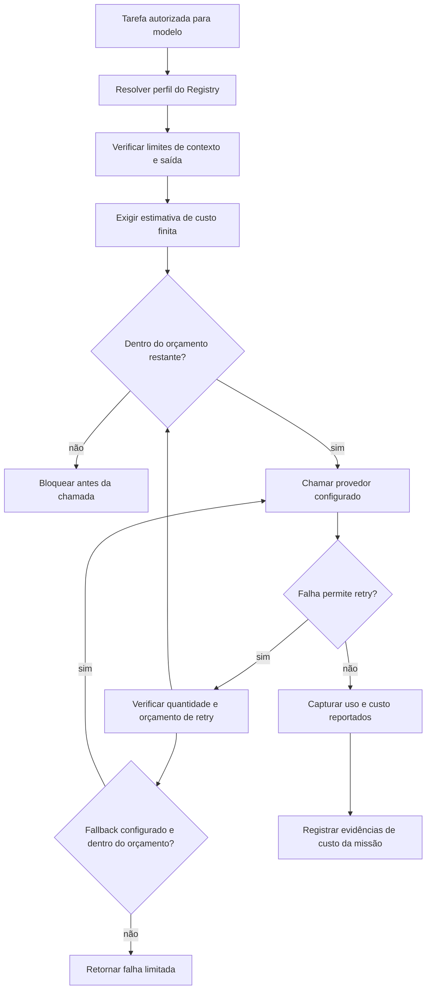

<p align="center">
  
</p>

<h1 align="center">Rill</h1>

<p align="center"><strong>Camada de Inteligência e Governança de Missões para Sistemas de IA</strong></p>

<p align="center">Agentes propõem. O Rill autoriza.</p>

<p align="center">
  <a href="https://rill.wesleysmacedo.com">Site</a> ·
  <a href="#conceitos-principais">Documentação</a> ·
  <a href="ARCHITECTURE.md">Arquitetura</a> ·
  <a href="ROADMAP.md">Roadmap</a> ·
  <a href="CONTRIBUTING.md">Contribuir</a> ·
  <a href="SECURITY.md">Segurança</a>
</p>

<p align="center">
  
  
  
  
  
  
  
  
</p>

> O Rill é um control plane para trabalho assistido por IA. Ele coloca políticas entre a proposta de um agente e os efeitos no sistema, permitindo definir o que é autorizado antes da execução.

## Prévia do Produto

Esta imagem é o conceito visual da interface Mission Control do Rill: uma proposta de visualização de conversa, estado da missão, escopo, especialistas, custos e governança em um único lugar.

<p align="center">
  
</p>

---

## O que é o Rill?

O Rill é uma **Camada de Inteligência e Governança de Missões para Sistemas de IA**. Ele foi projetado para classificar um objetivo, resolver seu escopo autorizado, aplicar políticas e coordenar trabalho assistido por modelos dentro de limites explícitos.

O Rill não é um modelo de IA, assistente de programação, chatbot, editor, substituto do VS Code/Cursor/Cline ou provedor de modelos. Clientes e modelos podem participar do trabalho, mas não detêm sua autoridade.

<table>
  <tr>
    <td width="33%"><strong>Escopo explícito</strong><br>Resolver o trabalho conforme ações, caminhos e limites de contexto registrados.</td>
    <td width="33%"><strong>Execução governada</strong><br>Aplicar políticas ao perfil do modelo, custo, risco e efeitos permitidos.</td>
    <td width="34%"><strong>Autoridade humana</strong><br>Exigir decisão atribuível quando o Registry requer aprovação.</td>
  </tr>
</table>

## Por que o Rill existe

Sistemas de IA podem combinar intenção do usuário, escolha do modelo, acesso ao repositório, execução de ferramentas e aprovação em um único ciclo. Quando essas decisões ficam implícitas, as equipes têm menos controle sobre escopo, custo, risco e responsabilização.

O Rill separa **autoridade, planejamento, execução, aprovação e auditoria**. O objetivo é simples: permitir que agentes ajudem no trabalho enquanto a autorização permanece em uma camada governada por políticas.

## Fluxo tradicional vs. Rill



O Rill torna explícito o caminho de autorização: **escopo delimitado, custo governado, aprovação humana quando exigida e resultados projetados para auditoria**.

## Modelo de autoridade

Em sistemas tradicionais, o agente pode receber autoridade direta por meio de suas ferramentas. O desenho do Rill coloca a autoridade no control plane: o agente pode propor trabalho, mas somente as políticas do Rill podem autorizar a ação e o escopo permitidos.



## Exemplo de missão

**Objetivo:** melhorar a interface do AuditQ.

O Registry diferencia planejamento de alteração. Uma análise read-only pode identificar melhorias; uma solicitação posterior de mudança é classificada como outra missão e precisa passar pela política de aprovação correspondente.

| Missão | Ação | Domínio | Risco | Perfil do modelo | Efeito |
| --- | --- | --- | --- | --- | --- |
| Analisar a interface | `PLAN_CHANGE` | `AuditQ` | `LOW` | `LOW_COST` | Plano read-only; o Registry atual não exige aprovação. |
| Implementar uma mudança aprovada | `PATCH_UI` | `AuditQ` | `MEDIUM` | `LOW_COST` | Aprovação humana explícita antes da alteração. |



## Status atual

| ✅ Blocos implementados | 🚧 Em andamento | 📋 Planejado |
| --- | --- | --- |
| Schema e resolver do Engineering Registry | Ingresso autenticado e persistência de missões | Governança multi-tenant |
| Context Resolver e contratos de manifesto | Integração ponta a ponta do Workflow | Mission Router V2 |
| Primitivas de políticas e orçamento | Retomada do workflow após decisão humana | Previsão de custos |
| Gateway OpenRouter com retry e fallback | Aplicação segura de propostas e executor | Versionamento e alteração de missões |
| Telemetria e sanitização Langfuse | Validação pós-execução, auditoria e APIs de relatório | Mais domínios e provedores |
| Módulos Architect, Builder e Reviewer | Contabilidade por missão | Política de releases e suporte |
| Operações HITL, helpers de persistência e gate de execução | Testes ponta a ponta de autorização |  |
| Contrato de transição de estados e servidor MCP stdio |  |  |

<details>
<summary>Notas de implementação</summary>

- A rota atual `POST /api/internal/rill/requests` classifica a solicitação e resolve o contexto. Ela ainda não autentica a service account, persiste uma missão ou inicia o Workflow.
- O Workflow executa o Agent Loop em dry-run. Após a aprovação, ainda não aplica um patch nem executa testes pós-execução.
- O caminho de aplicação do Builder é um protótipo, não um executor de patches seguro para produção. O MCP anuncia ferramentas de consulta de estado, proposta e relatório cujas rotas ainda não estão todas implementadas.
- O Registry atual cobre `PLAN_CHANGE`, `PATCH_UI` e `VALIDATE_CHANGE` no domínio `AuditQ`. `PLAN_CHANGE` é read-only e não exige aprovação; `PATCH_UI` exige aprovação humana explícita.
- `PROPOSAL_READY` aparece no fluxo-alvo abaixo, mas não faz parte do contrato atual de estados de execução.
- A imagem do dashboard acima é um conceito visual, não uma captura de uma aplicação em execução. Métricas, aprovações e estados exibidos são ilustrativos, não dados reais ou autoritativos. O diretório `docs/architecture/` não contém imagens PNG exportadas; os diagramas Mermaid são usados nesta documentação.
- Os badges indicam integrações e escolhas tecnológicas presentes no repositório, não que o ciclo completo de missão esteja implantado ou pronto para produção.

</details>

## Início rápido

Instale as dependências, experimente o classificador e execute os testes:

```bash
npm install
npm run classify -- "Analise a UI do Audit Q em public/index.html"
npm test
```

<details>
<summary>Executar o servidor MCP stdio</summary>

```bash
npm run mcp
```

O servidor MCP usa stdio. Configure `RILL_BASE_URL`, `RILL_MCP_CLIENT_ID` e `RILL_MCP_CLIENT_SECRET` somente ao conectá-lo a um serviço sob seu controle.

</details>

## Conceitos principais

| Conceito | Significado |
| --- | --- |
| Missão | Unidade governada de trabalho com ação, domínio, política, ciclo de vida e resultado. |
| Inteligência de Missão | Classificação e análise de intenção, escopo, risco e estratégia de execução. |
| Engineering Registry | Regras versionadas para ações, domínios, caminhos, limites, aprovações e validações. |
| Context Resolver | Cria um manifesto de contexto a partir de alvos explícitos e entradas de apoio registradas. |
| Especialista | Papel como Architect, Builder ou Reviewer; não uma identidade fixa de modelo. |
| Proposta | Descrição estruturada dos alvos, mudanças, critérios, riscos e testes pretendidos. |
| HITL | Decisão humana em um ponto de aprovação definido por política. |
| Gate de execução | Verifica aprovação, estado da missão e integridade da proposta antes de produzir efeitos. |

## Visão geral da arquitetura

O Rill separa o ingresso da solicitação e a autorização determinística do trabalho assistido por modelos e da execução com efeitos. O Registry fornece políticas, o Context Resolver monta um manifesto delimitado e o Workflow coordena especialistas e eventuais decisões humanas.



## Componentes

| Componente | Responsabilidade | Área do repositório |
| --- | --- | --- |
| Inteligência de Missão e Router | Classificar solicitações e resolver ação, papel e perfil de modelo. | `src/classification/`, `src/routing/`, `src/runtime/` |
| Engineering Registry | Definir políticas de ação/domínio, caminhos, limites, aprovações e validações. | `engineering-registry.json`, `engineering-registry.schema.json` |
| Context Resolver | Resolver arquivos-alvo explícitos e contexto de apoio registrado. | `src/routing/context-resolver.ts` |
| Módulos de política | Aplicar regras de execução, segurança e orçamento. | `src/policies/` |
| Workflow Engine | Coordenar etapas duráveis, esperas e estado da missão. | `src/workflows/` |
| Especialistas | Planejar, propor e revisar trabalho. | `src/workers/` |
| HITL e gate de execução | Registrar decisões humanas e verificar autorização para prosseguir. | `src/hitl/`, `src/security/gated-executor.ts` |
| Gateway de modelos | Encaminhar chamadas estruturadas dentro do perfil e orçamento. | `src/gateway/` |
| Persistência e observabilidade | Armazenar registros de missão e emitir telemetria sanitizada. | `src/infrastructure/`, `src/telemetry/` |

## Ciclo de vida da missão



## Governança

O modelo de governança do Rill separa decisões de recomendações:

- O Registry e o código de políticas autorizam ação, domínio, contexto e limites.
- Os especialistas produzem plano, proposta ou revisão dentro desse escopo.
- A aprovação humana só é exigida quando a política determina.
- O executor deve verificar a proposta aprovada e o estado atual da missão.
- Evidências de validação e auditoria fundamentam o resultado terminal.

### Fluxo de aprovação humana



## Governança de custos

O gateway de modelos verifica o perfil configurado, limites de contexto e saída, custo estimado, retentativas e orçamento de fallback antes e durante chamadas ao provedor. Uso reportado e custo estimado são valores distintos; quando o provedor não informa o custo, ele deve permanecer desconhecido em vez de parecer exato.



## Segurança

O Rill foi concebido em torno de autoridade mínima: contexto explícito, escopo de arquivos registrado, entradas minimizadas para modelos, credenciais mantidas no runtime, verificações de política antes de efeitos e decisão humana quando exigida. O control plane deve bloquear a operação quando classificação, escopo, validação ou autorização forem incertos.

Não inclua credenciais de provedores no código nem envie segredos ou dados pessoais a um modelo sem uma política de dados explícita e revisada. Consulte [SECURITY.md](SECURITY.md) para orientações sobre relatos de vulnerabilidade.

## Auditabilidade

Um registro útil de missão deve permitir inspecionar ação e domínio, resultado da política, manifesto de contexto, identidade da proposta, achados do Reviewer, decisão humana, resultado da execução, evidências de validação, custo e referência do trace. Os dados de auditoria devem ser minimizados, atribuíveis, controlados por acesso e retidos conforme uma política explícita.

## Observabilidade

O repositório inclui adaptadores Langfuse e sanitização de telemetria para eventos relacionados a modelos e missões. Observabilidade ajuda a explicar comportamento e custo; não substitui registros de autorização nem evidências de validação.

## Desenvolvimento

Requisitos: Node.js e npm.

```bash
npm install
npm test
npm run classify -- "Analise a UI do Audit Q em public/index.html"
```

Para iniciar o processo MCP stdio, execute `npm run mcp`. Configuração de deployment e segredos de runtime dependem do ambiente; não armazene credenciais nos arquivos do projeto.

## Contribuir

Comece por [CONTRIBUTING.md](CONTRIBUTING.md), consulte as notas de arquitetura em [ARCHITECTURE.md](ARCHITECTURE.md) e execute `npm test` antes de abrir um pull request. Proponha primeiro em uma issue ou discussão de arquitetura as mudanças que afetem autoridade, políticas, estados ou persistência.

## Comunidade

O Rill é comunitário. Use issues do GitHub para bugs reproduzíveis e propostas focadas, discussões de arquitetura para tradeoffs, ADRs para decisões aceitas e RFCs para mudanças transversais. Mantenha a discussão baseada em evidências e diferencie o comportamento implementado do desenho proposto. Siga o [Código de Conduta](CODE_OF_CONDUCT.md).

## Roadmap

| Status | Foco |
| --- | --- |
| ✅ Implementado | Primitivas de Registry/contexto, módulos especialistas, gateway, controles de orçamento, contratos HITL e adaptadores de persistência/telemetria. |
| 🚧 Em andamento | Ingresso autenticado, integração de Workflow, execução segura, validação, contabilidade e relatórios. |
| 📋 Planejado | Governança multi-tenant, Mission Router V2, previsão de custos, alterações de missão e mais domínios/provedores. |

Consulte [ROADMAP.md](ROADMAP.md) para detalhes.

## Licença

O Rill está sob a [Licença Apache 2.0](LICENSE). Ela permite uso comunitário e comercial conforme seus termos, incluindo disposições explícitas sobre patentes. Este resumo é informativo e não constitui aconselhamento jurídico.

Mantido por [Wesley de Souza Macedo](https://rill.wesleysmacedo.com) · [Site](https://rill.wesleysmacedo.com)
